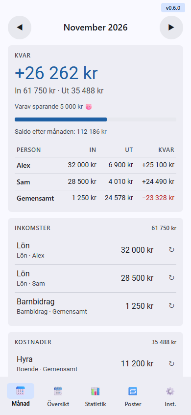
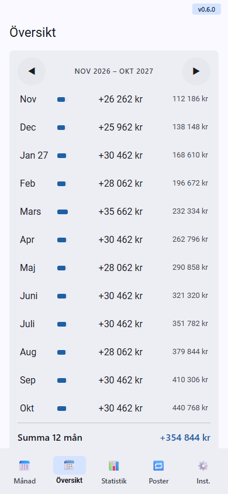
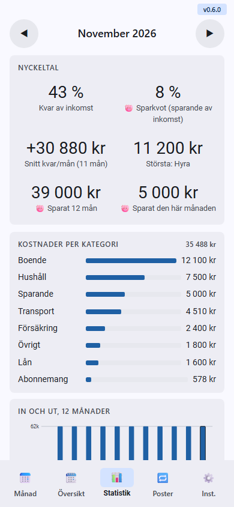
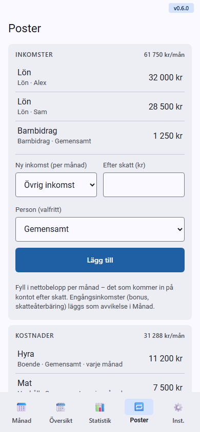
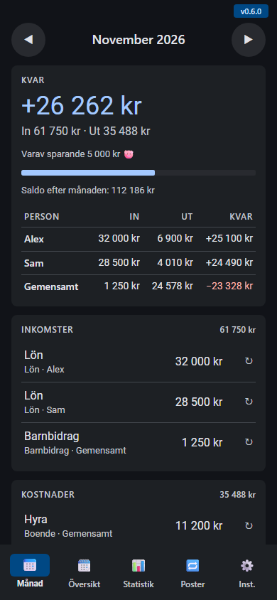
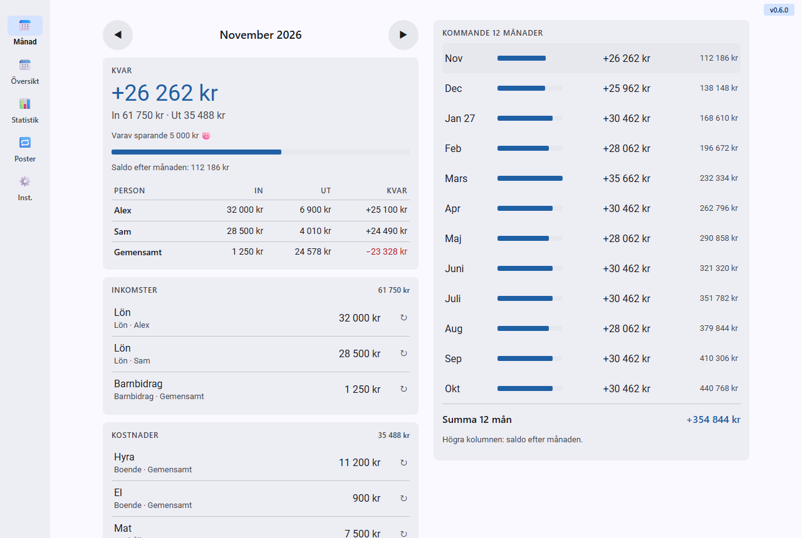

# Budget buddy

**Plan your finances month by month – income, bills and the unexpected.**

### [▶ Open the app](https://flyinggooner.github.io/budget-buddy/)

[📱 Presentation of the app](https://flyinggooner.github.io/budget-buddy/docs/presentation.html) · [🛡️ Small apps, big needs](https://flyinggooner.github.io/budget-buddy/docs/standard.html)

  
  

  
  

The screenshots show made-up example data.

## Why?

Most budget apps want you to log every purchase. Budget buddy does the opposite: you enter income and fixed bills once, and only fill in the deviations – new tyres, a dentist's bill – in the month they belong to. Then you see right away how each month adds up, even months ahead.

## Features

| | |
|---|---|
| 📅 **Month** | What is left after the month's expenses – and how much you save. |
| 🔁 **Fixed items** | Salary and bills are entered once – every month, every other month, quarter or year. |
| ✏️ **Deviations** | New tyres or a dentist's bill go in the month they belong to. An amount can be changed for one month only. |
| 📈 **Overview** | The next 12 months and the balance after each month. |
| 📊 **Statistics** | Key figures, savings rate, expenses by category and in/out over the last 12 months. |
| 🐷 **Savings** | The category Savings is shown separately: "of which savings" and how much you have saved. |
| 🏦 **Savings accounts** | Fill in the balance of your savings accounts each month and see the change – also in other currencies, converted to your currency. |
| 💱 **Your currency** | Kronor, euro, dollar, pound, Norwegian or Danish kroner. Changing currency converts all amounts with the built-in rates (with Undo). |
| 👥 **People** | Optional: who an item belongs to, or Shared, with a table per person. |
| 🌍 **Language** | English or Swedish, chosen at the first start and changeable in Settings. |
| ↩️ **Undo** | Deleted items can be undone for a few seconds, and the trash keeps them for 30 days. |
| 💾 **Backup** | Save all data as a password-encrypted file and restore it – on the same or another device. |
| ❓ **Help** | Manual with pictures right in the app, in both languages. |
| 📴 **Offline** | Works without network after the first visit. |
| ↩️ **Back** | The phone's back button goes back through the tabs you have visited. |
| 🌗 **Theme** | Light and dark, follows the phone's setting. |

## Why your data is safer here 🛡️

This app holds your entire financial life – salary, loans, bills and savings. Here is why that is safer than in a typical app:

**Hacked company database** – the most common way sensitive data leaks

- Typical app with an account: Your data sits in a database with millions of others – a prime target
- **This app:** There is no database. Your data is only in your phone, so an attacker would have to get into *your* phone

**Your data is sold or shared**

- Typical app with an account: Common in free apps, and many paid ones share with partners for ads and analytics
- **This app:** No account, no analytics, no ads, no trackers – and the browser technically blocks every request out

**Employees or partners read it**

- Typical app with an account: Possible – the company holds the data
- **This app:** Nobody but you has it

**The company shuts down or is sold**

- Typical app with an account: Your data goes with it
- **This app:** The app and your data stay on your phone

**Backup in the cloud**

- Typical app with an account: Readable by the company
- **This app:** Encrypted with AES-256 and your password before it leaves the phone

**Is it the safest possible way?** For personal data like this, keeping it only on your own device, with no server and an encrypted backup, is as safe as a practical app gets – there is simply nothing central to steal. It is not magic, though: your phone itself must be locked and kept updated, the backup password must be strong, and you trust that the code served from GitHub Pages is the published, reviewed code (it is all open on GitHub for anyone to check).

## Privacy and security 🔒

- **No account, no cookies.** Everything is stored only in your browser (`localStorage`).
- **Nothing from outside.** No analytics, no ads, no fonts or scripts from outside – also blocked technically with a Content Security Policy. Even the exchange rates are built into the app and updated at each release; it never fetches anything.
- **Encrypted backup.** The backup file is always encrypted with a password you choose: AES-GCM 256 bits, and the key is derived with PBKDF2-SHA256 and 600,000 iterations – the level OWASP recommends and the same as the default in the password manager Bitwarden. A new salt and IV every time, and a file that has been changed cannot be restored. Only the browser's built-in crypto is used, no libraries from outside.

### Compared with typical budget apps

| | This app | Typical budget apps |
|---|---|---|
| Account | None | Required, often with email |
| Where the data is | Only in your phone | On the company's servers |
| Analytics, ads, trackers | None – blocked technically | Common |
| Backup | Encrypted file only your password opens | In the company's cloud |
| If the service shuts down | The app and the data remain | The data may disappear |

> **Honest about the limits:** the data in the phone is protected by the phone's own lock, not by separate encryption – lock your phone. A forgotten password cannot be recovered, and a weak password can be guessed, so choose a long one. If you clear site data everything disappears, so save a backup file now and then (Settings → Data).

### Security tested ✅

Automatic tests run before every new version and every upload. Failed test = no release.

**Security check**
- [x] **Only the app's own code runs** – the browser blocks everything else.
- [x] **Nothing leaves the phone** – the app never talks to any server; even the exchange rates are built in.
- [x] **Your data stays with you** – stored only in the phone; the app only touches its own data.
- [x] **Works offline** – with only the app's own files.
- [x] **Locked backup** – only your password opens the file. The password is never stored in the file.

**Function tests**
- [x] **Broken files are stopped** – a backup from the wrong app, or one someone has changed, is not restored.
- [x] **No content can become code** – everything is shown as plain text.
- [x] **Backup round trip** – gives identical data; Delete only empties the app's own data.
- [x] **Correct totals** – everything is counted in whole öre/cents.

## Install on your phone

**Android (Chrome)**
1. Open [the app](https://flyinggooner.github.io/budget-buddy/) in Chrome.
2. Tap the menu **⋮** → **Install app** (or *Add to Home screen*).

**iPhone (Safari)**
1. Open [the app](https://flyinggooner.github.io/budget-buddy/) in Safari.
2. Tap **Share** → **Add to Home Screen**.

The version number is shown at the top right of the app. New versions are fetched automatically.

## For developers

Plain HTML, CSS and JavaScript – no frameworks, no dependencies, no build step for the app.

**Run locally:** serve the folder statically, e.g. `python3 -m http.server 8080`, and open http://localhost:8080 (the service worker needs `localhost` or HTTPS).

**Test file:** `tools\build-single.ps1` bakes the app into a single file, `dist/budget-buddy.html`, which can be opened directly in the browser or sent to someone.

| File | Contents |
|---|---|
| `index.html` | The app's markup |
| `styles.css`, `app.js` | Style and logic |
| `store.js` | Storage in `localStorage`, validation of saved data, export/import and currency conversion (`changeHome`) |
| `backup.js` | Saving and reading the backup file (shared by all apps, original in the workspace template) |
| `i18n.js`, `i18n-en.js` | Language support: the source text is Swedish; `i18n.js` (shared by all apps) translates what is drawn with the dictionary in `i18n-en.js` |
| `version.js` | Version number (single source) |
| `sw.js`, `manifest.webmanifest`, `icons/` | Installation as an app (PWA) and offline |
| `docs/SPEC.md` | Specification of features and behaviour |
| `docs/MANUAL.md`, `docs/MANUAL.en.md` | The manual in Swedish and English (the same text as Help in the app) |
| `docs/presentation.html` | Stand-alone mobile presentation of the app (English by default, Swedish with the button on the first slide) |
| `docs/standard.html` | Small apps, big needs – what all the apps have in common (synced from the template) |
| `tools/build-single.ps1` | Builds the test file |
| `tools/tests/` | Unit and flow tests (run in headless Edge) |
| `tools/update-rates.ps1` | Fetches ECB rates (Frankfurter) into `store.js` – run automatically before every commit |
| `CLAUDE.md` | Rules for development |

Published to GitHub Pages from `main`.
