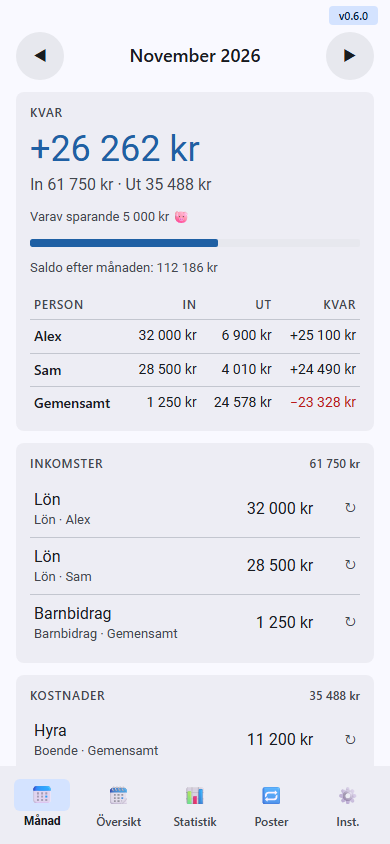
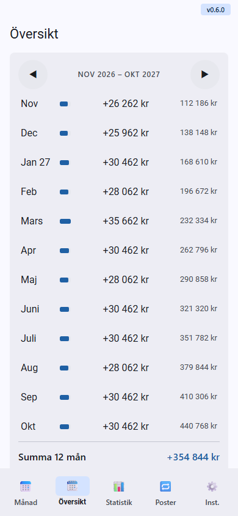
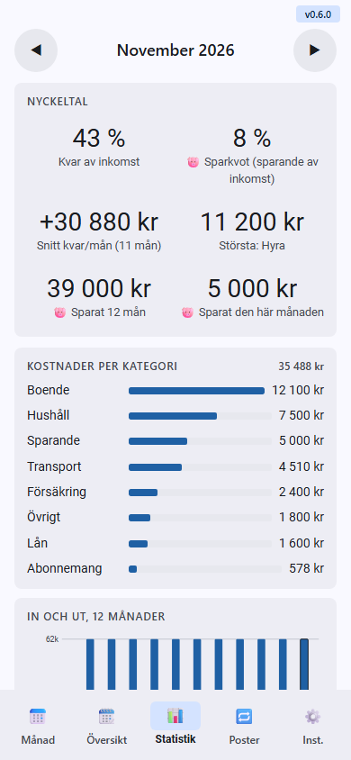
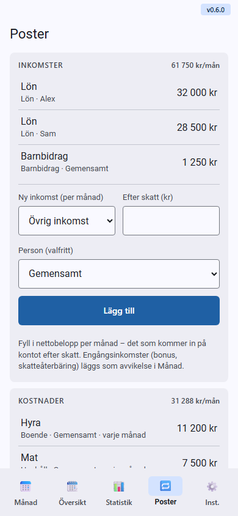
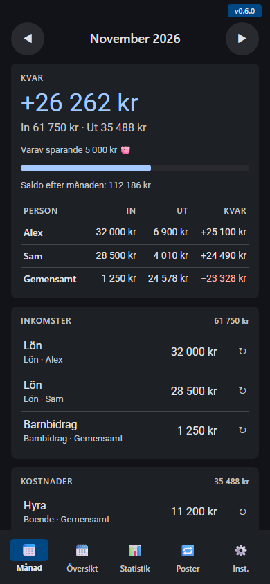
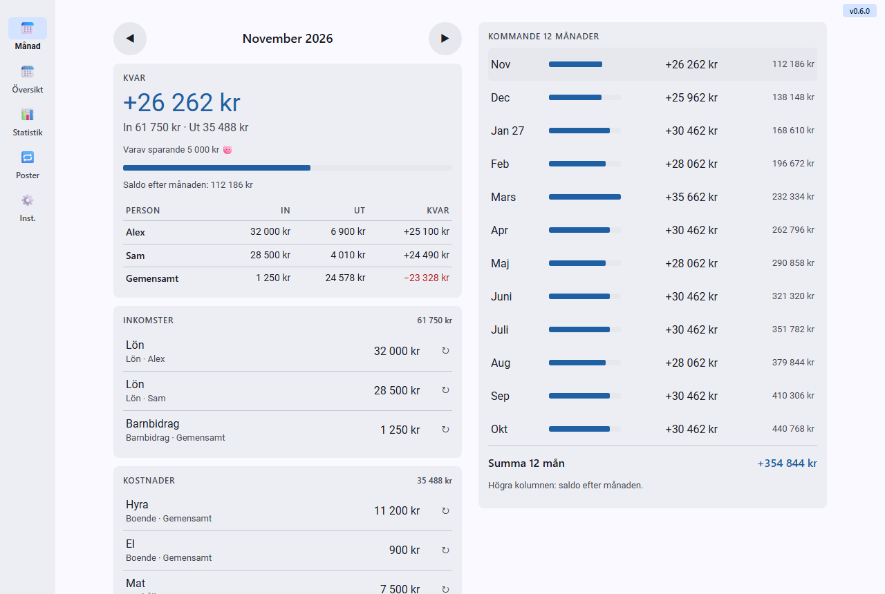

# Budget buddy

**Planera ekonomin månad för månad – inkomster, räkningar och det oväntade.**

### [▶ Öppna appen](https://flyinggooner.github.io/Budget-buddy/)

[📱 Presentation av appen](https://flyinggooner.github.io/Budget-buddy/docs/presentation.html) · [🛡️ Små appar, hög nivå](https://flyinggooner.github.io/Budget-buddy/docs/standard.html)

  
  

  
  

Skärmbilderna visar påhittad exempeldata.

## Varför?

De flesta budgetappar vill att du loggar varje köp. Budget buddy gör tvärtom: du lägger in inkomster och fasta räkningar en gång, och fyller bara i avvikelserna – nya däck, en tandläkarräkning – på den månad de hör till. Då ser du direkt hur varje månad går ihop, även månader framåt.

## Funktioner

| | |
|---|---|
| 📅 **Månad** | Vad som är kvar efter månadens kostnader – och hur mycket du sparar. |
| 🔁 **Fasta poster** | Lön och räkningar läggs in en gång – varje månad, varannan, kvartal eller år. |
| ✏️ **Avvikelser** | Nya däck eller en tandläkarräkning läggs på den månad den hör till. Ett belopp kan ändras för bara en månad. |
| 📈 **Översikt** | Kommande 12 månader och saldot efter varje månad. |
| 📊 **Statistik** | Nyckeltal, sparkvot, kostnader per kategori och in/ut de senaste 12 månaderna. |
| 🐷 **Sparande** | Kategorin Sparande visas separat: "varav sparande" och hur mycket du sparat. |
| 🏦 **Sparkonton** | Fyll i saldot på dina sparkonton varje månad och se förändringen – även i utländsk valuta, omräknat till kronor. |
| 👥 **Personer** | Valfritt: vem en post hör till, eller Gemensamt, med en tabell per person. |
| ↩️ **Ångra** | Borttagna poster kan ångras i några sekunder. |
| 💾 **Backup** | Spara all data som en lösenordskrypterad fil och läs in den igen – på samma eller en annan enhet. |
| ❓ **Hjälp** | Manual med bilder direkt i appen. |
| 📴 **Offline** | Fungerar utan nät efter första besöket. |
| 🌗 **Tema** | Ljust och mörkt, följer telefonens inställning. |

## Integritet och säkerhet 🔒

- **Inget konto, inga cookies.** Allt sparas bara i din webbläsare (`localStorage`).
- **Inget utifrån.** Ingen analys, inga annonser, inga typsnitt eller skript utifrån – spärras även tekniskt med en Content Security Policy. Även valutakurserna är inbyggda i appen; den hämtar aldrig något.
- **Krypterad backup.** Backup-filen krypteras alltid med ett lösenord du väljer: AES-GCM 256 bitar, och nyckeln tas fram med PBKDF2-SHA256 och 600 000 iterationer – den nivå OWASP rekommenderar och samma som förvalet i lösenordshanteraren Bitwarden. Nytt salt och ny IV varje gång, och en fil som ändrats går inte att läsa in. Bara webbläsarens inbyggda krypto används, inga bibliotek utifrån.

### Jämfört med vanliga budgetappar

| | Den här appen | Vanliga budgetappar |
|---|---|---|
| Konto | Inget | Krävs, ofta med e-post |
| Var datan finns | Bara i din telefon | På företagets servrar |
| Analys, annonser, spårare | Inga – spärrat tekniskt | Vanligt |
| Backup | Krypterad fil som bara ditt lösenord öppnar | I företagets moln |
| Om tjänsten läggs ner | Appen och datan finns kvar | Datan kan försvinna |

> **Ärligt om gränserna:** datan i telefonen skyddas av telefonens eget lås, inte av en egen kryptering – lås telefonen. Ett glömt lösenord går inte att återställa, och ett svagt lösenord kan gissas, så välj ett långt. Rensar du webbplatsdata försvinner allt, så spara en backup-fil då och då (Inställningar → Data).

### Säkerhetstestad ✅

Automatiska tester körs före varje ny version och varje uppladdning. Underkänt test = ingen release.

**Säkerhetskontroll**
- [x] **Bara appens egen kod körs** – webbläsaren blockerar allt annat.
- [x] **Inget lämnar telefonen** – appen pratar aldrig med någon server; även valutakurserna är inbyggda.
- [x] **Din data stannar hos dig** – sparas bara i telefonen; appen rör bara sina egna uppgifter.
- [x] **Fungerar utan nät** – med bara appens egna filer.
- [x] **Låst backup** – bara ditt lösenord öppnar filen. Lösenordet sparas aldrig.

**Funktionstester**
- [x] **Trasiga filer stoppas** – en backup från fel app, eller som någon ändrat i, läses inte in.
- [x] **Inget innehåll kan bli kod** – allt visas som vanlig text.
- [x] **Backup tur och retur** – ger identisk data; Radera tömmer bara appens egna data.
- [x] **Rätt summor** – allt räknas i hela ören.

## Installera på mobilen

**Android (Chrome)**
1. Öppna [appen](https://flyinggooner.github.io/Budget-buddy/) i Chrome.
2. Tryck på menyn **⋮** → **Installera app** (eller *Lägg till på startskärmen*).

**iPhone (Safari)**
1. Öppna [appen](https://flyinggooner.github.io/Budget-buddy/) i Safari.
2. Tryck på **Dela** → **Lägg till på hemskärmen**.

Versionsnumret syns uppe till höger i appen. Nya versioner hämtas automatiskt.

## För utvecklare

Ren HTML, CSS och JavaScript – inga ramverk, inga beroenden, inget byggsteg för appen.

**Köra lokalt:** servera mappen statiskt, t.ex. `python3 -m http.server 8080`, och öppna http://localhost:8080 (service workern kräver `localhost` eller HTTPS).

**Testfil:** `tools\build-single.ps1` bakar ihop appen till en enda fil, `dist/budget-buddy.html`, som går att öppna direkt i webbläsaren eller skicka till någon.

| Fil | Innehåll |
|---|---|
| `index.html` | Appens markup |
| `styles.css`, `app.js` | Stil och logik |
| `store.js` | Lagring i `localStorage`, validering av sparad data och export/import |
| `backup.js` | Spara och läsa backup-fil (gemensam för alla appar, original i arbetsytans mall) |
| `version.js` | Versionsnummer (enda källan) |
| `sw.js`, `manifest.webmanifest`, `icons/` | Installation som app (PWA) och offline |
| `docs/SPEC.md` | Specifikation av funktioner och beteende |
| `docs/MANUAL.md` | Manualen (samma text som Hjälp i appen) |
| `docs/presentation.html` | Fristående mobilpresentation av appen |
| `docs/standard.html` | Små appar, hög nivå – det alla appar har gemensamt (synkas från mallen) |
| `tools/build-single.ps1` | Bygger testfilen |
| `tools/tests/` | Enhets- och flödestester (körs i headless Edge) |
| `tools/update-rates.ps1` | Hämtar ECB-kurser (Frankfurter) till `store.js` – körs automatiskt före varje commit |
| `CLAUDE.md` | Regler för utveckling |

Publiceras till GitHub Pages från `main`.
