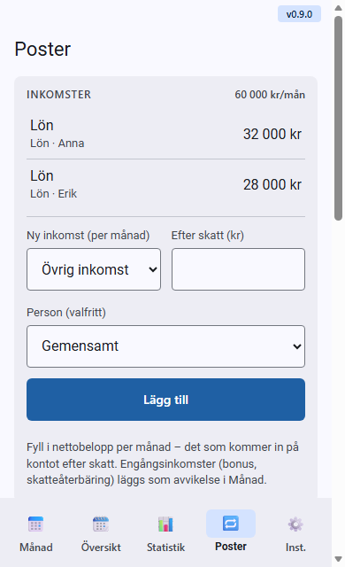
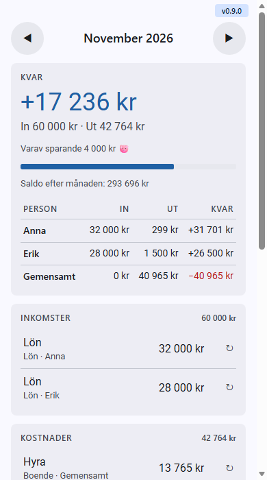
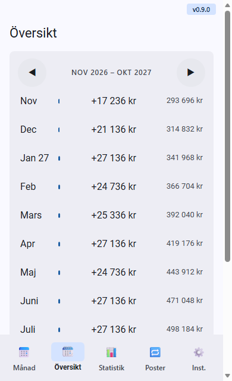
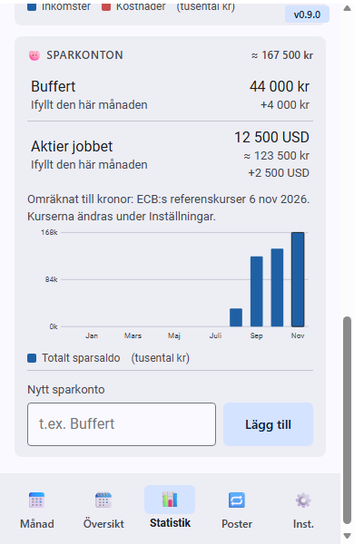
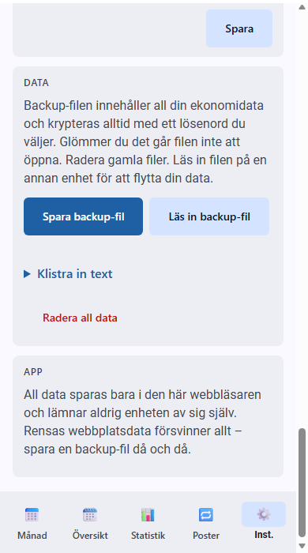

# Budget buddy – how to use the app

The same text is in the app under **Settings → Help** when English is chosen. Write only here: Help in `index.html` is built from this file with `tools/build-help.ps1` (Swedish: `MANUAL.md`).

## Get started

- Go to **Items** and add your income (after tax) and fixed expenses. Say how often an expense comes – every month, every other month, quarterly or once a year – and from which month.
- Everything is entered once. After that the app works out every month for you.
- **Select several items:** hold your finger on an item until it is selected and tap more. **End** sets a last month on all selected (the history is kept), **Remove** puts them in the trash. Undo is available right afterwards. ✕ or Back ends.
- **Sort items:** tap **↕** above Income. The columns Amount, Name, Category and Start then show. Tap a column to sort by it, and the same column again to reverse the order (↑ ascending, ↓ descending). The choice applies to both income and expenses and is saved.

## Why your data is safe here
- This app holds your whole financial life: salary, loans, bills, savings and who in the household pays what. That should not end up with a company, an advertiser or a hacker.
- **No server to hack.** Most big leaks happen when a company's database with millions of users' data is hacked. There is no such database here: your data is only in your phone. Anyone who wants it has to get into your particular phone.
- **Nothing to sell.** Many free apps – and paid ones too – make money from your data or share it with partners for ads and analytics. This app has no account, no analytics, no ads and no trackers. The browser also technically blocks every request out, so the data cannot be sent anywhere, not even by mistake.
- **Locked backup.** The backup file is encrypted with AES-256 and your password. If you put it in the cloud, the cloud service only sees unreadable data.
- **Open code.** All the code is public on GitHub and can be reviewed by anyone.
- **Honestly: nothing is 100 % safe.** What remains is your own phone – lock it with a code and keep it updated – a weak backup password, and that the app's code on GitHub Pages is not changed by someone unauthorised. But for this kind of data there is no safer practical way than never letting it leave the phone.

## Month

- Shows what is left after the month's expenses, and how much of it is savings.
- Change month with **◀ ▶** or swipe left/right. Tap a line to change the amount for this month only. **+ Deviation** adds a one-off item, e.g. new tyres or a dentist's bill.

## Overview

- The next 12 months at once. Months with a deficit are marked.
- Fill in a **Starting balance** under Settings to see the running balance after each month.

## Statistics and savings

- Key figures, savings rate, expenses by category and in/out over the last 12 months. Expenses in the category **Savings** are shown as savings.
- **Savings accounts** (at the bottom of Statistics): add an account and fill in what is on it each month. The account can have another currency (e.g. USD); the total is then converted to your currency with the rates under Exchange rates.

## People and categories
- Optional: add the people in the household, so each item can belong to a person or be shared. Categories can be renamed, added and removed.

## Trash
- Items, deviations and savings accounts you delete end up in the **Trash** under Settings. They stay there for 30 days and can be brought back with **Restore**, with their changed amounts per month. Then they are deleted for good. **Empty the trash** deletes everything at once (Undo is available right afterwards).

## Language and currency
- The first time, you choose the language (Svenska or English) and your currency (kronor, euro, dollar, pound, Norwegian or Danish kroner) in the welcome box. Change them later under **Settings → Language and currency**.
- If you change currency when you already have data, all amounts (income, expenses, deviations, starting balance and the trash) are converted with the exchange rates. Undo is available right afterwards. Savings accounts keep their own currency.
- Numbers are always written the same way (1 250,50), whatever the language.

## Exchange rates
- The app has approximate rates from the ECB built in (the date is shown in the card). They are updated when the app is updated – the app never fetches rates itself. You can enter your own rates and tap Save; **Use the app's rates** resets them. The rates are in Swedish kronor per unit, whatever your currency.

## Backup and moving

- Under **Data**: tap **Save backup file**. The file is called e.g. budget-buddy-2026-11-09.txt and ends up among your downloads (in the Claude app you confirm first). Do it now and then.
- To restore: tap **Restore backup file** and choose the file, check the summary and tap **Replace**. All current data is replaced – **Undo** is available right afterwards.
- If you cannot choose the file: open **Paste text** and paste the file's contents.
- The file contains all your financial data and is always encrypted with a password the app creates and stores for you the first time it starts (Show and Change in Settings). Tick **Show password** to see what you type. **Create random password** fills in a strong password you can copy – save it in a password manager. If you forget the password the file cannot be opened. Delete old files.
- The backup password is stored on the device the first time you enter it (when you save or restore a backup). After that a backup takes one tap, without a question. The password is only on this device, never in the backup file, and the file is just as encrypted as before. With **Show password** ticked you only need to type the password once. Under Settings → Data you can **Show** and **Change** the password, or untick **Remember the backup password** – it is then forgotten and the app asks every time. Use a new password you do not use anywhere else: it is stored unprotected on this device. Tap **Create random password** and save it in your password manager. Keep the password in your password manager – without it the backup cannot be opened on a new phone.
- The app is locked until you have chosen a language and a password for your backup files – the first time, after Delete all data and as long as no password is saved. If you have a backup file you can restore it instead; the password that opens it is saved. The app collects no data – the password is just a key that protects your backups. If you restore a backup that the saved password unlocks, the summary says so; if it does not fit, the app asks for the password for that file.

## Back
- The phone's back button first closes the box that is open, then the selection mode. After that it goes back through the tabs you have visited. The app closes only in the tab you started in.

## Install and offline
- **Android (Chrome):** the ⋮ menu → Install app. **iPhone (Safari):** Share → Add to Home Screen.
- Installed, the app works completely offline. New versions are fetched automatically.

## Privacy
- The app makes no requests – no server, no bank connection, no analytics, no account. All data is only in this browser.
- If you clear site data everything disappears. So: save a backup file now and then.
