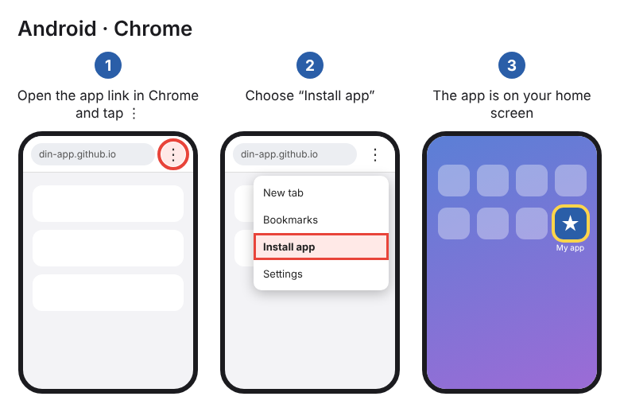

# Budget buddy – how to use the app

The same text is in the app under **Settings → General → Help and manual**. Write only here: Help in `index.html` is built from this file with `node tools/build-help.mjs` (or `tools/build-help.ps1`).

## Get started
- Under **Month** there is the **＋ Add** button. Choose **Income** (salary after tax), **Cost** (rent, electricity, loans …), **Saving** or **Only this month** (a one-off).
- Everything is entered once and then applies every month. The app works out what is left.
- Paid on another day than the 1st? Choose **Payday** under Settings → Household.

## Month
- **After bills** at the top is what remains after costs and savings – the money to live on (food, fun and other variable spending). When the month is closed it says **Left in the account** instead: what was actually left. Below it the comparison with last month, and the bar shows where the income goes. The amounts are in the cards below.
- **Income**, **Expenses** and **Total saved** share one card and are folded – tap a row to see it. Expenses are grouped by category. Below them are **After bills** (income minus expenses, the same amount as at the top) and **Saved this month** with its share of income.
- Tap a row to change the amount for this month. Under **More** you find **Edit item (all months)** (name, amount, category, period), **Skip this month**, **Reset to regular** and **Delete**. **+ Add to Housing** adds a cost with the same category, person and frequency.
- Change month with **◀ ▶** or swipe. Tap **Month** in the menu to return to the current month.
- **＋ Add**, **☰ All items** and **🔒 Close** (or **🔓 Edit** in a closed month) sit in one row at the bottom. **☰ All items** shows all recurring items, including ended and upcoming ones. Items are listed largest amount first, there and in Month. Tap one to change it.
- Below the buttons you see how many days are left until the next payday (current month) and which category changed the most since last month. The card also shows last month: left in the account if it is closed, otherwise after bills.
- **Left at close** (forecast) is on the same line, once at least one earlier month is closed: after bills minus variable spending (average of the three latest closed months). If the same month last year is closed, the variable spending from that month is used instead – if December was expensive last year, the forecast counts on that. Tap the forecast for the explanation.
- **Recent and upcoming months** (Overview): the last three months at the top (closed ones with what was left in the account), then after bills for the next three months (tap **Show all 12 months** for the rest) and, once a month is closed, the forecast next to it. Tap a month to open it.
- **Savings goal** (optional): open a savings account and tap **+ Savings goal**. Enter an amount and, if you like, a month it should be done by. Below the account you see how far you have come, when you reach the goal at the current pace and – with a date – what is needed per month to make it. Empty the field to remove the goal.
- Tap an item to change it. The amount at the top applies only to the month you are viewing; the rest is under **More**. **Delete** puts the item in the trash.
- To end an item, fill in **To month**. Items that have ended or not started show in the months they apply to.

## Savings
- Savings and savings accounts are the same thing. **＋ Add → 🐷 Savings** picks or creates an account with **Value**, **From pay / mo** and **Before pay / mo**.
- **From pay** is a cost: it is listed under Expenses → Savings and reduces After bills. **Before pay** (e.g. shares through work) never reaches your pay account and does not affect the budget. Both count in **Saved this month**.
- The value goes up with the saving every month (marked ≈). When you **close the month** the suggestion (last value + saving) is prefilled – enter the real value from the bank, and next month counts up from there. Funds move, so the suggestion is only a help.
- The **Total saved** row in Month shows the sum in your currency; tap to see each account. Accounts in another currency show their own amount in brackets, e.g. (730 USD).
- Tap an account (under Total saved, Expenses → Savings or All items) to change it. Under **More settings**: name, currency, savings goal, Show in Month and Delete account (it goes to the trash). A hidden account still counts in Total saved. When you save, **Undo** is shown for a moment.
- The total and a chart of all accounts are in **Overview**.

## Close the month
- After bills is planned. Food, fun and unexpected spending do not show there.
- Below Left it says when it is time to close (e.g. *Close the month Tue 24 Nov · in 6 days*). Three days before, the line gets a colour, and when the day has come it says **Time to close the month**.
- The day before payday, tap **🔒 Close** at the bottom and enter what was actually left in the account. If the money stays in the account, leave **The money stays and carries over** ticked – the amount then becomes the row **Left over from last month** (⇢) in the next month. If you move it, e.g. to the savings account, untick it. In the first month, or if last month isn't closed, fill it in yourself with **+ Left over from last month** under Income. In the same dialog you reconcile the savings accounts (prefilled – only change what differs).
- The heading then becomes **Left in the account** with the actual amount, and the difference is shown as **Variable** in the bar. The next month becomes the current one right away.
- **Credit cards:** add the bill as an expense and tick **Credit card bill – entered when the month is closed** (also under **More** on the item). The amount can be left empty. Months without an entered bill are estimated: the same month last year plus the increase your bills have had compared with the year before (so season and inflation are included). With no bill from last year, the average of the three latest is used, and with no bills at all the amount on the item. When you close a month there is a row per card: enter the bill taken on the next payday – with payday on the 25th you enter the bill paid 25 Nov (October's purchases) when you close November, and it becomes an expense in December (25 Nov – 24 Dec).
- Once you have started closing months, months that are not closed are shown at the top of Month (**Not closed: Oct**) – tap to go there. In a closed month, tap **🔓 Edit**: correct the amount there, or remove the closing with **Reopen**.

## Payday
- Under **Settings → Household → Payday** you choose which day the budget month starts. The 1st means normal calendar months.
- With payday on the 25th, the salary on 25 November covers December. That month is called **December**, with **25 Nov – 24 Dec** below.
- If you change payday the items move along, so November is still November (Undo is available). If the current month is empty but the next has items, **Start the items in …** is shown – tap it to move everything back one month.
- If payday falls on a Saturday or Sunday, the app assumes the salary arrives the Friday before, and the new month (with its savings) starts on that Friday. **Close month** always asks for the balance on the last weekday before payday, usually the Thursday when the salary comes on Friday.

## Overview
- At the top **last month** – the latest one you have closed: **Spending** (what was left after bills and savings minus what was actually left over – food, fun and the rest), **🐷 Total saved** (the total in the savings accounts) and **Left in the account**. ▲▼ shows the difference from the month before.
- Then the savings accounts total with a chart, and **Month by month**: spending and saved for each closed month. Tap a month to open it.
- The overview is based on closed months – close the month the day before payday (see above).

## People and categories
- Optional: add the people in the household under **Settings → Household**. Each item can then belong to a person or be shared, and the card shows In, Out and After bills per person. **Split evenly** shows what is left per person if the shared part is split evenly.
- Categories can be renamed, added and removed.

## Currency and rates
- The home currency is chosen under **Settings → Currency** (kronor, euro, dollar, pound, Norwegian or Danish kroner). If you change it, all amounts are converted (Undo is available). Savings accounts keep their own currency.
- The app has the ECB reference rates built in. They are updated every weekday when the app is updated – the app never fetches rates itself. Your own rates can be entered under **Exchange rates**.

## Trash
- Items, deviations and savings accounts you delete stay in **Trash** under Settings → General for 30 days and can be brought back with **Restore**.

## Backup and moving
- Under **Settings → General → Data**: tap **Save backup file** now and then. To restore: **Load backup file**, check and tap **Replace** (Undo is available).
- The file is always locked with **your code** (Show, Copy, New code). Save the code in your password manager – you need it on a new phone.
- Under **More options**: Export CSV, Paste text, Choose your own code and Delete all data.

## Why your data is safe here
- **No server to hack.** Your data is only on your phone.
- **Nothing to sell.** No account, no analytics, no ads. The browser technically blocks all outgoing calls.
- **Locked backup.** The backup file is encrypted with AES-256 and your code.
- **Open source** on GitHub. Lock your phone with a code and keep it updated.

## Install as an app

- **Android (Chrome):** open the app link, tap ⋮ at the top right and choose **Install app**.

- **iPhone (Safari):** open the link in Safari, tap **Share** (the box with the arrow) and choose **Add to Home Screen** → **Add**.
- Installed, the app works like a normal app, even offline.
- If you clear site data, everything is gone – save a backup file now and then.

## Back
- The back button first closes the open dialog, then selection mode, then goes back through the tabs.
