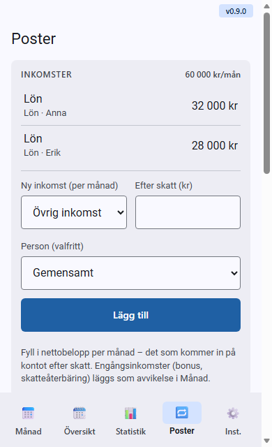
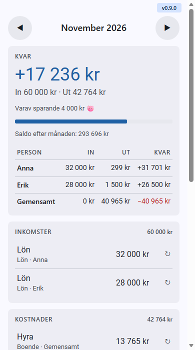
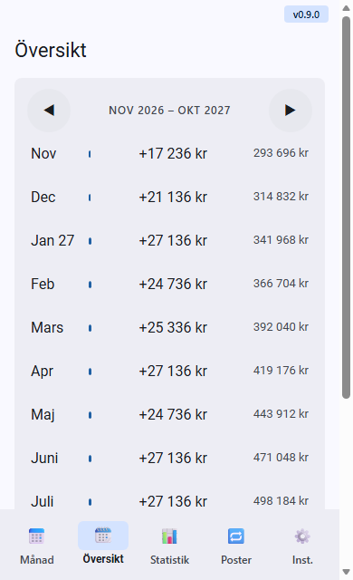
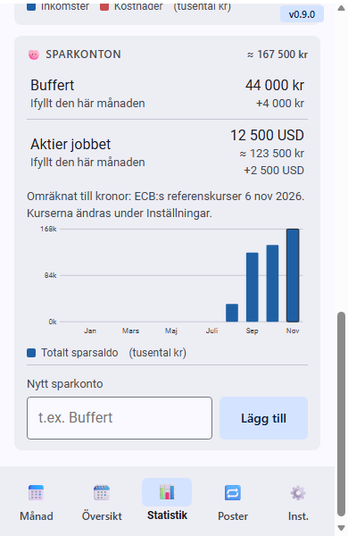
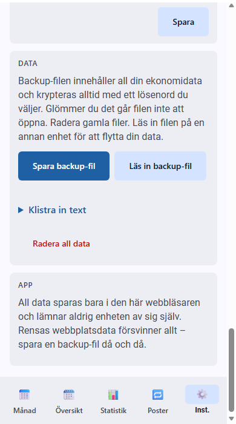

# Budget buddy – så använder du appen

Samma text finns i appen under **Inställningar → Hjälp**. Skriv bara här: Hjälp i `index.html` byggs från den här filen med `tools/build-help.ps1`.

## Kom igång

- Gå till **Poster** och lägg in dina inkomster (efter skatt) och fasta kostnader. Ange hur ofta en kostnad kommer – varje månad, varannan, kvartal eller en gång om året – och från vilken månad.
- Allt läggs in en gång. Sedan räknar appen ut varje månad åt dig.
- **Markera flera poster:** håll fingret på en post tills den blir markerad och tryck på fler. **Avsluta** sätter en sista månad på alla markerade (historiken bakåt finns kvar), **Ta bort** lägger dem i papperskorgen. Ångra finns direkt efteråt. ✕ eller Bakåt avslutar.
- **Sortera poster:** tryck på **↕** ovanför Inkomster. Då visas kolumnerna Belopp, Namn, Kategori och Start. Tryck på en kolumn för att sortera på den, och på samma kolumn igen för att vända ordningen (↑ stigande, ↓ fallande). Valet gäller både inkomster och kostnader och sparas.

## Varför din data är säker här
- Här finns hela din ekonomi: lön, lån, räkningar, sparande och vem i hushållet som betalar vad. Sådant ska inte hamna hos ett företag, en annonsör eller en hackare.
- **Ingen server att hacka.** De flesta stora läckor sker när ett företags databas med miljontals användares uppgifter hackas. Här finns ingen sådan databas: din data finns bara i din telefon. Den som vill åt den måste komma åt just din telefon.
- **Inget att sälja.** Många gratisappar – och även betalappar – tjänar pengar på din data eller delar den med partner för annonser och analys. Den här appen har inget konto, ingen analys, ingen reklam och inga spårare. Webbläsaren spärrar dessutom tekniskt alla anrop ut, så datan kan inte skickas iväg ens av misstag.
- **Låst backup.** Backup-filen krypteras med AES-256 och ditt lösenord. Lägger du den i molnet ser molntjänsten bara obegriplig data.
- **Öppen kod.** All kod ligger öppet på GitHub och kan granskas av vem som helst.
- **Ärligt: inget är 100 % säkert.** Det som återstår är din egen telefon – lås den med kod och håll den uppdaterad – ett svagt backup-lösenord, och att appens kod på GitHub Pages inte ändras av någon obehörig. Men för den här sortens uppgifter finns inget säkrare praktiskt sätt än att de aldrig lämnar telefonen.

## Månad

- Visar vad som är kvar efter månadens kostnader, och hur mycket av det som är sparande.
- Byt månad med **◀ ▶** eller svep åt vänster/höger. Tryck på en rad för att ändra beloppet bara den här månaden. **+ Avvikelse** lägger till en engångspost, t.ex. nya däck eller en tandläkarräkning.

## Översikt

- De kommande 12 månaderna på en gång. Månader med underskott markeras.
- Fyll i ett **Startsaldo** under Inställningar för att se det löpande saldot efter varje månad.

## Statistik och sparande

- Nyckeltal, sparkvot, kostnader per kategori och in/ut de senaste 12 månaderna. Kostnader i kategorin **Sparande** visas som sparande.
- **Sparkonton** (längst ner i Statistik): lägg till ett konto och fyll i vad som står på det varje månad. Kontot kan ha en annan valuta (t.ex. USD); då räknas summan om till din valuta med kurserna under Valutakurser.

## Personer och kategorier
- Valfritt: lägg till personerna i hushållet, så kan varje post höra till en person eller vara gemensam. Kategorierna kan byta namn, läggas till och tas bort.

## Papperskorg
- Poster, avvikelser och sparkonton som du tar bort hamnar i **Papperskorg** under Inställningar. Där ligger de i 30 dagar och kan tas tillbaka med **Återställ**, med sina ändrade belopp per månad. Sedan raderas de för gott. **Töm papperskorgen** raderar allt på en gång (Ångra finns direkt efteråt).

## Språk och valuta
- Appen är på svenska med kronor från början. Byt språk och valuta (kronor, euro, dollar, pund, norska eller danska kronor) under **Inställningar → Språk och valuta**.
- Byter du valuta när du redan har data räknas alla belopp (inkomster, kostnader, avvikelser, startsaldo och papperskorgen) om med valutakurserna. Ångra finns direkt efteråt. Sparkonton behåller sin egen valuta.
- Tal skrivs alltid likadant (1 250,50), oavsett språk.

## Valutakurser
- Appen har ungefärliga kurser från ECB inbyggda (datumet står i kortet). De uppdateras när appen uppdateras – appen hämtar aldrig kurser själv. Du kan skriva in egna kurser och trycka Spara; **Använd appens kurser** återställer. Kurserna är i kronor per enhet, oavsett vilken valuta du har.

## Backup och flytt

- Under **Data**: tryck **Spara backup-fil**. Filen heter t.ex. budget-buddy-2026-11-09.txt och hamnar bland hämtade filer (i Claude-appen bekräftar du först). Gör det då och då.
- För att läsa tillbaka: tryck **Läs in backup-fil** och välj filen, kontrollera sammanfattningen och tryck **Ersätt**. All nuvarande data ersätts – **Ångra** finns direkt efteråt.
- Går det inte att välja filen: öppna **Klistra in text** och klistra in filens innehåll.
- Filen innehåller all din ekonomidata och krypteras alltid med ett lösenord som appen skapar och sparar åt dig första gången den startas (Visa och Byt under Inställningar). Bocka i **Visa lösenord** om du vill se vad du skriver. **Skapa slumpmässigt lösenord** fyller i ett starkt lösenord som du kan kopiera – spara det i en lösenordshanterare. Glömmer du lösenordet går filen inte att öppna. Radera gamla filer.
- Backup-lösenordet sparas på enheten första gången du skriver det (när du sparar eller läser in en backup). Sedan sparas backup med ett tryck, utan fråga. Lösenordet ligger bara på den här enheten, aldrig i backup-filen, och filen är lika krypterad som förut. Bockar du i **Visa lösenord** räcker det att skriva lösenordet en gång. Under Inställningar → Data kan du **Visa** och **Byta** lösenordet, eller bocka ur **Kom ihåg backup-lösenordet** – då glöms det och appen frågar varje gång. Använd ett nytt lösenord som du inte har någon annanstans: det sparas oskyddat på den här enheten. Tryck **Skapa slumpmässigt lösenord** och spara det i din lösenordshanterare. Behåll lösenordet i din lösenordshanterare – utan det går backupen inte att öppna på en ny telefon.
- Backup-lösenordet skapas och sparas automatiskt första gången appen startas (och efter Radera all data). Se eller byt det under Inställningar; spara det t.ex. i en lösenordshanterare. Appen samlar ingen data – lösenordet är bara en nyckel som skyddar dina backuper. Läser du in en backup som det sparade lösenordet låser upp står det i sammanfattningen; passar det inte frågar appen efter lösenordet för den filen.

## Bakåt
- Telefonens bakåtknapp stänger först den ruta som är öppen, sedan markeringsläget. Därefter går den tillbaka genom flikarna du besökt. Appen stängs först i fliken du började i.

## Installera och offline
- **Android (Chrome):** menyn ⋮ → Installera app. **iPhone (Safari):** Dela → Lägg till på hemskärmen.
- Installerad fungerar appen helt utan nät. Nya versioner hämtas automatiskt.

## Integritet
- Appen gör inga anrop – ingen server, ingen bankkoppling, ingen analys, inget konto. All data finns bara i den här webbläsaren.
- Rensar du webbplatsdata försvinner allt. Därför: spara en backup-fil då och då.
