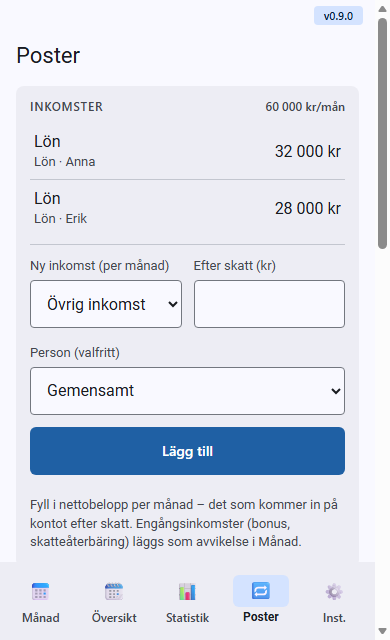
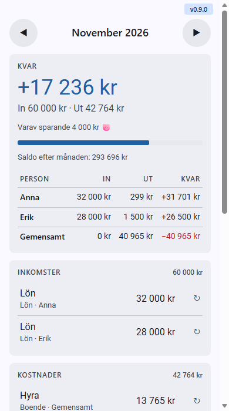
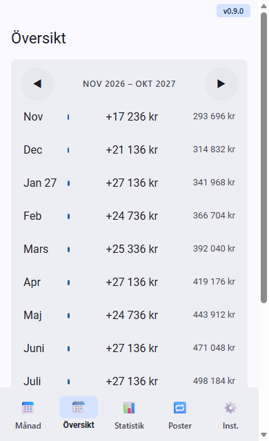
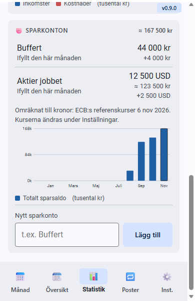
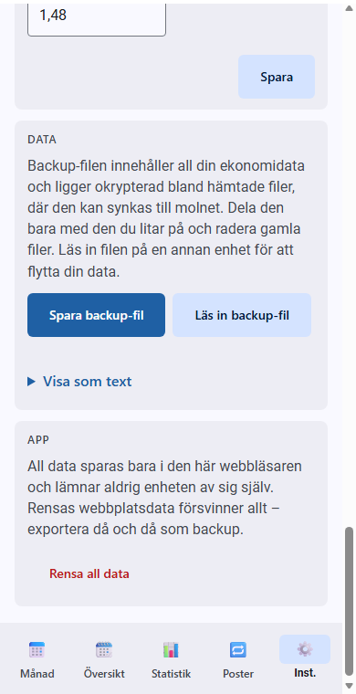

# Budget buddy – så använder du appen

Samma text finns i appen under **Inställningar → Hjälp**. Ändras den ena: ändra den andra (kortet `help` i `index.html`).

## Kom igång

- Gå till **Poster** och lägg in dina inkomster (efter skatt) och fasta kostnader. Ange hur ofta en kostnad kommer – varje månad, varannan, kvartal eller en gång om året – och från vilken månad.
- Allt läggs in en gång. Sedan räknar appen ut varje månad åt dig.

## Månad

- Visar vad som är kvar efter månadens kostnader, och hur mycket av det som är sparande.
- Byt månad med **◀ ▶** eller svep åt vänster/höger. Tryck på en rad för att ändra beloppet bara den här månaden. **+ Avvikelse** lägger till en engångspost, t.ex. nya däck eller en tandläkarräkning.

## Översikt

- De kommande 12 månaderna på en gång. Månader med underskott markeras.
- Fyll i ett **Startsaldo** under Inställningar för att se det löpande saldot efter varje månad.

## Statistik och sparande

- Nyckeltal, sparkvot, kostnader per kategori och in/ut de senaste 12 månaderna. Kostnader i kategorin **Sparande** visas som sparande.
- **Sparkonton** (längst ner i Statistik): lägg till ett konto och fyll i vad som står på det varje månad. Kontot kan ha en annan valuta (t.ex. USD); då räknas summan om till kronor med kurserna under Valutakurser.

## Personer och kategorier
- Valfritt: lägg till personerna i hushållet, så kan varje post höra till en person eller vara gemensam. Kategorierna kan byta namn, läggas till och tas bort.

## Valutakurser
- Appen har ungefärliga kurser från ECB inbyggda (datumet står i kortet). Du kan skriva in egna kurser och trycka Spara; **Använd appens kurser** återställer.

## Backup och flytt

- Under **Data**: tryck **Spara backup-fil**. Filen heter t.ex. budget-buddy-2026-11-09.txt och hamnar bland hämtade filer (i Claude-appen bekräftar du först). Gör det då och då.
- För att läsa tillbaka: tryck **Läs in backup-fil** och välj filen, kontrollera sammanfattningen och tryck **Ersätt**. All nuvarande data ersätts – **Ångra** finns direkt efteråt.
- Går det inte att spara eller välja filen: öppna **Visa som text**. Där finns samma innehåll att kopiera och klistra in.
- Filen innehåller all din ekonomidata och är okrypterad. Dela den bara med den du litar på och radera gamla filer.

## Installera och offline
- **Android (Chrome):** menyn ⋮ → Installera app. **iPhone (Safari):** Dela → Lägg till på hemskärmen.
- Installerad fungerar appen helt utan nät. Nya versioner hämtas automatiskt.

## Integritet
- Appen gör inga anrop – ingen server, ingen bankkoppling, ingen analys, inget konto. All data finns bara i den här webbläsaren.
- Rensar du webbplatsdata försvinner allt. Därför: spara en backup-fil då och då.
